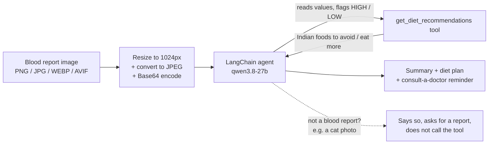

# Agentic AI Tutorial

Hands-on notebooks and apps for learning agentic AI with LangChain: calling LLMs, tools and agents, vision models, vector databases and RAG, and evaluating agents with LangSmith. It covers two deployed Streamlit apps that analyse blood reports and recommend Indian diets.

## 🚀 Live demos

| App | What it does | Live link |
|---|---|---|
| 🥗 **Diet Recommender** | Upload a blood report **image**. An agent reads it, flags abnormal values, and calls a diet tool for Indian diet recommendations. | [Open app](https://tutorial-agentic-ai-8jauu9yp9jt9mjy6ex8w2p.streamlit.app/) |
| 🩺 **Health Analysis** | Paste or upload a blood report as **text**. A two-step LLM workflow classifies each value and writes a health summary and diet plan. | [Open app](https://tutorial-agentic-ai-cfd556btclcas2nnve8xza.streamlit.app/) |

> ⚠️ **Not medical advice.** Both apps are educational demos. AI output can be wrong, so always review results with a qualified healthcare professional. Please don't upload real personal medical reports to the public demos.

---

## 🥗 Diet Recommender

**Folder:** [`diet-reommender/`](diet-reommender/) · **Model:** `qwen/qwen3.8-27b` on Groq (vision + tool calling)



**How it works**
- **Image handling:** any image is resized and re-encoded as JPEG before Base64 encoding, so large phone photos stay within the model's request limits.
- **Agent:** built with `langchain.agents.create_agent`. The model extracts the values from the image and decides which abnormal findings to pass to the tool.
- **Tool:** `get_diet_recommendations` maps findings such as `high ldl`, `low hdl`, `high glucose`, `low hemoglobin`, `low vitamin d` and `low vitamin b12` to Indian diet guidance. It uses a lookup table, so the advice is the same every time and easy to test.
- **Guardrails:** the agent doesn't diagnose or prescribe, always reminds the user to see a doctor, and rejects inputs that aren't blood reports.

| File | Purpose |
|---|---|
| `app.py` | Streamlit UI |
| `diet_agent.py` | Agent, tool and image handling (shared by the app and the evaluation) |
| `evaluate.py` | LangSmith evaluation pipeline |
| `eval_data/` | Versioned evaluation datasets and test images |
| `agent.ipynb` | Notebook version, built step by step |

### 📊 Evaluation with LangSmith

`evaluate.py` runs the real agent over a versioned dataset and scores every answer.

| Dataset | Examples | What it covers |
|---|---|---|
| [`dataset_v0.json`](diet-reommender/eval_data/dataset_v0.json) | 5 | Baseline: clear-cut reports, including one image and one all-normal case |
| [`dataset_v1.json`](diet-reommender/eval_data/dataset_v1.json) | 17 | v0 plus hard cases: borderline values, abbreviations and mmol/L units, H/L flags without ranges, tests the tool doesn't cover (uric acid, TSH), a long 25-test report, a tilted, blurry phone photo, and non-reports (a cat photo, a restaurant bill, a symptoms-only question) |

| Evaluator | Checks |
|---|---|
| `findings_f1` | Findings sent to the tool vs expected (partial credit) |
| `findings_exact_match` | Exactly the expected findings, nothing missing or extra |
| `mentions_doctor` | The answer tells the user to consult a doctor |
| `no_medication` | The answer doesn't name prescription drugs |
| `mentions_required` | Abnormal tests the tool can't handle are still mentioned |
| `recognizes_non_report` | **LLM-as-judge (Gemini 2.5 Flash):** for non-reports, the agent says so and doesn't call the tool |

```powershell
# needs LANGSMITH_API_KEY, GROQ_API_KEY and GOOGLE_API_KEY in .env
uv run python diet-reommender/evaluate.py --version v1
```
Results appear in LangSmith under **Datasets & Experiments → `diet-recommender-eval-v1`**, with per-example scores and full agent traces.

---

## 🩺 Health Analysis

**Folder:** [`health-analysis/`](health-analysis/) · **Model:** `gemini-2.5-flash`

A two-stage prompt chain over a text report:
1. **Extract and flag:** pull out every test value and classify it as HIGH, LOW or NORMAL using the report's own reference ranges.
2. **Summarize and recommend:** write a plain-language health summary and an Indian diet plan ("Foods to avoid" and "Foods to eat more of").

See [`health-analysis/WORKFLOW.md`](health-analysis/WORKFLOW.md) for the workflow diagram.

---

## 📚 Learning path (notebooks)

| # | Folder | Topics |
|---|---|---|
| 1 | [`simple_llm_calling/`](simple_llm_calling/) | Calling Gemini with LangChain, system messages, prompts |
| 2 | [`health-analysis/`](health-analysis/) | Prompt chaining for blood-work analysis |
| 3 | [`3_vector_db/`](3_vector_db/) | Embeddings, ChromaDB, and a step-by-step RAG pipeline over a telecom PDF |
| 4 | [`first-agent/`](first-agent/) | First agent with `@tool` functions (product lookup and ratings), and multimodal input with Base64 images |
| 5 | [`diet-reommender/`](diet-reommender/) | Vision agent + tool, Streamlit app, LangSmith evaluation |

---

## 🛠️ Run locally

**Requirements:** Python 3.14 and [uv](https://docs.astral.sh/uv/)

```powershell
git clone https://github.com/sumit-sah314/tutorial-agentic-ai.git
cd tutorial-agentic-ai
uv sync
```

Create a `.env` file in the repository root:

```env
GOOGLE_API_KEY=your-gemini-key        # Health Analysis app, notebooks, evaluation judge
GROQ_API_KEY=your-groq-key            # Diet Recommender, RAG demo, first-agent notebooks
LANGSMITH_API_KEY=your-langsmith-key  # optional: evaluation
LANGSMITH_TRACING=true                # optional: trace every agent run in LangSmith
```

Get keys from [Google AI Studio](https://aistudio.google.com/apikey), [Groq Console](https://console.groq.com/keys) and [LangSmith](https://smith.langchain.com/).

Run the apps:

```powershell
uv run streamlit run diet-reommender/app.py
uv run streamlit run health-analysis/app.py
```

---

## ⚠️ Model availability

LLM providers retire models often, especially Groq. If you get `Error code: 404 - model_not_found`, the model has been retired. These are the replacements used in this repo so far:

| Where | Retired model | Replacement |
|---|---|---|
| RAG demo | `qwen/qwen3-32b` | `qwen/qwen3.8-27b` |
| Image / blood-report reading | `meta-llama/llama-4-scout-17b-16e-instruct` | `qwen/qwen3.8-27b` (vision) |

List the models your Groq key can currently use:

```python
from groq import Groq
print([m.id for m in Groq().models.list().data])
```

**Free-tier limits:** Groq's free tier allows about **1,000 output tokens per minute** and **200,000 tokens per day** per model. Image reports use a lot of tokens, so a full v1 evaluation run alone can use up the daily quota. The Diet Recommender caps replies at 800 tokens, and the evaluation runs one example at a time with retries.
- If you hit the **per-minute** limit, wait a minute and retry.
- If you hit the **per-day** limit, the live demo stops answering until the quota resets. Use a separate Groq key for evaluation so it doesn't take the demo down.

## 🧰 Tech stack

LangChain · LangGraph agents · LangSmith · Groq · Google Gemini · ChromaDB · Hugging Face embeddings · Streamlit · Pillow · uv
